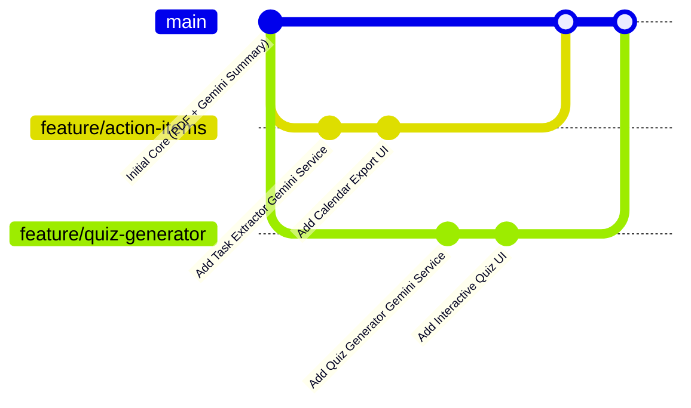

# 🚀 SmartNotes AI – מופעל על ידי Google Gemini AI

מערכת חכמה ומדויקת לסיכום פגישות, הרצאות ומסמכי PDF באמצעות **Google Gemini AI**, הכוללת ממשק משתמש מודרני, תמיכה מלאה בקובצי PDF, ומבנה מודולרי ייעודי לתרגול עבודה מקבילה בענפים ומיזוג ב-Git.

---

## 📁 מבנה הפרויקט

```text
smartnotes-ai/
├── public/                 # קובצי ה-Frontend
│   ├── index.html          # שלד הממשק + מודל מפתח API + לשוניות לענפים
│   ├── style.css           # עיצוב מודרני עם תמיכה מלאה ב-RTL
│   └── app.js              # לוגיקת צד-לקוח, ניהול מפתח Gemini ושליחה
├── services/               # שירותי Backend
│   ├── aiService.js        # שירות AI חי הפונה ישירות ל-Gemini Flash
│   └── pdfService.js       # חילוץ טקסט מקובצי PDF (באמצעות pdf-parse)
├── server.js               # שרת Express ראשי ונקודות קצה
├── BRANCH_PROMPT_1_TASKS.md # הנחיות מפורטות לפיתוח ענף 1 (משימות ויומן)
├── BRANCH_PROMPT_2_QUIZ.md  # הנחיות מפורטות לפיתוח ענף 2 (בוחן הבנה)
├── package.json            # תלויות הפרויקט
├── .env                    # קובץ הגדרות סביבה ומפתח Gemini API
└── .gitignore              # קובץ סינון ל-Git (מונע העלאת node_modules ו-.env)
```

---

## ⚡ הרצה והגדרת מפתח Gemini AI

1. **הפעלת השרת**:
   בטרמינל בתיקייה זו (`C:\Users\Windows 10\Desktop\smartnotes-ai`):
   ```bash
   npm start
   ```

2. **פתיחת הממשק בדפדפן**:
   גשו לכתובת: **[http://localhost:3000](http://localhost:3000)**

3. **הגדרת מפתח Gemini API**:
   * **דרך הממשק (הכי קל):** לחצו על כפתור **"הגדרת Gemini Key"** בראש העמוד, הדביקו את המפתח שלכם ולחצו "בדוק ושמור מפתח".
   * **או דרך קובץ `.env`:** הדביקו את המפתח בקובץ `.env`:
     ```env
     GEMINI_API_KEY=AIzaSy...
     ```
   * 🎁 *עדיין אין לכם מפתח?* תוכלו להוציא מפתח חינמי תוך חצי דקה ב-[Google AI Studio](https://aistudio.google.com/app/apikey).

---

## 🌿 מפת הדרכים לעבודה עם Git (עבודה בשני ענפים)



### 👤 ענף 1 (אתה) – משימות وייצוא ליומן
* **שם הענף:** `feature/action-items`
* **מה מפתחים:** חילוץ משימות (Action Items), אחראים, עדיפויות וכפתור ייצוא ל-Google Calendar / Outlook.
* **הנחיות מלאות וקוד:** פתחו את `BRANCH_PROMPT_1_TASKS.md`.

### 👥 ענף 2 (השותף/ה) – בוחן הבנה וציון אמריקאי
* **שם הענף:** `feature/quiz-generator`
* **מה מפתחים:** יצירת שאלון אמריקאי אינטראקטיבי לבדיקת הבנה של תוכן ה-PDF באמצעות Gemini עם ציון ומשוב מיידי.
* **הנחיות מלאות וקוד:** פתחו את `BRANCH_PROMPT_2_QUIZ.md`.

---

## 🔀 תהליך המיזוג (Merge)
1. מפתח ענף 1 מסיים, דוחף את הענף שלו ופותח **Pull Request**.
2. לאחר בדיקה, ממזגים את ענף 1 אל `main`.
3. מפתח ענף 2 מושך את השינויים מ-`main` אל הענף שלו, פותר קונפליקט מיזוג קל ומוגדר ב-`server.js` וב-`app.js`, וממזג גם הוא!
